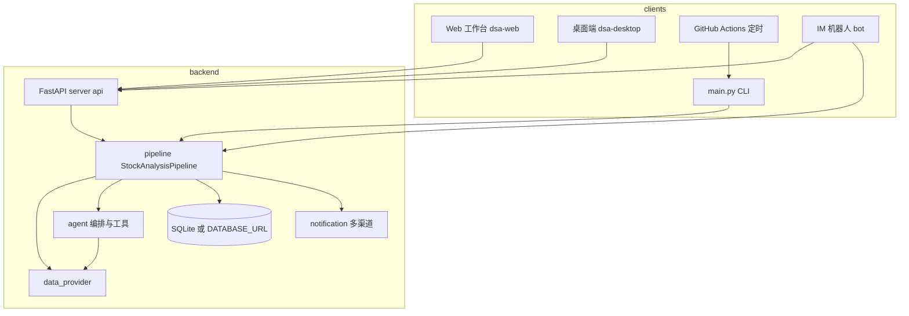
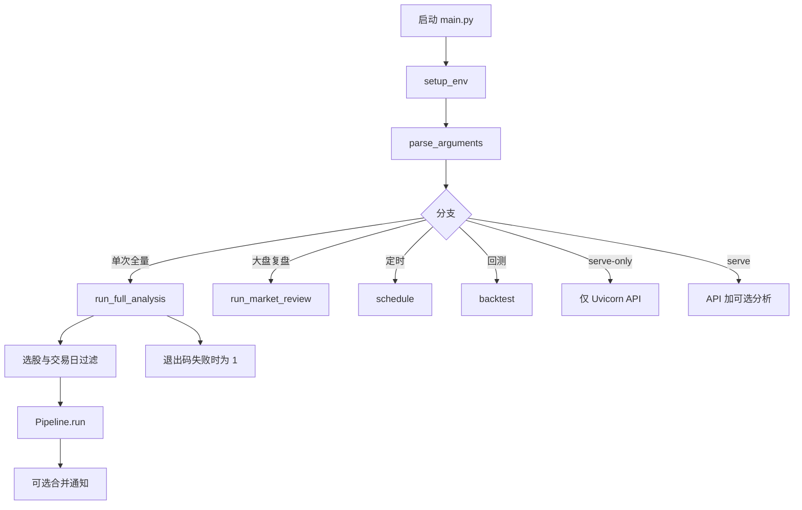
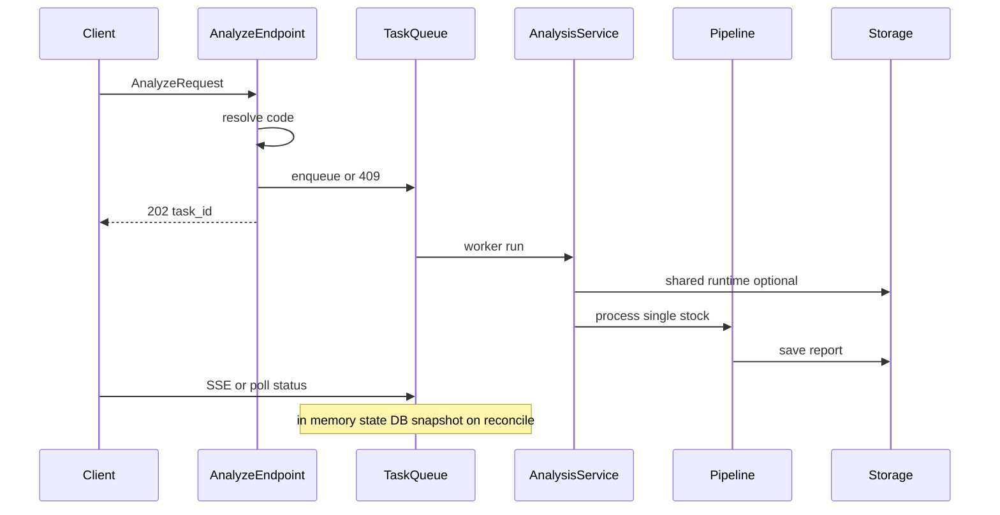
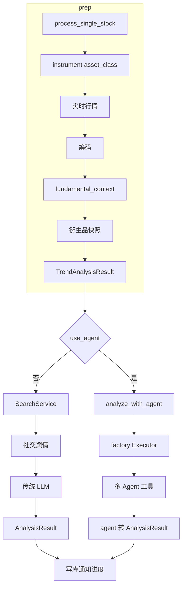
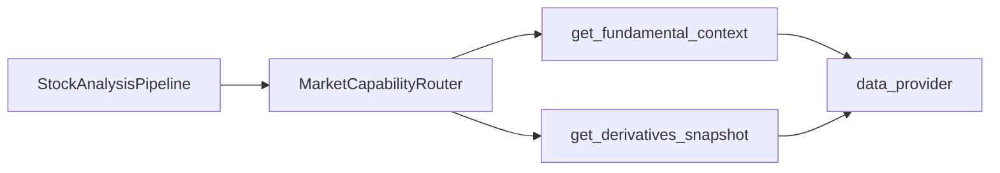

# 项目架构与主链路详解

本文面向需要**通读代码**的开发者，在 [`project-architecture-analysis.md`](./project-architecture-analysis.md) 的目录表基础上，补充**调用顺序、分支条件与流程图**。若与实现不一致，以可运行代码为准；发现漂移时请更新本节或架构分析文档。

**相关入口文档**

| 文档 | 用途 |
|------|------|
| [README.md](../README.md) / [README_EN.md](./README_EN.md) | 功能列表、配置 Secrets、快速开始 |
| [full-guide.md](./full-guide.md) | 部署与排障细节 |
| [agent-capabilities.md](./agent-capabilities.md) | Agent 与传统 pipeline 的能力边界 |
| [small-scale-operations.md](./small-scale-operations.md) | 小流量部署边界与「不必做」项 |
| [timezone-policy.md](./timezone-policy.md) | 时区与 `utc_now` 约定 |

---

<!-- English anchor for README_EN: advisory-vs-execution-boundary -->

## 辅助交易与实盘边界

本系统在架构上**不承担真实证券/期货/加密货币报单**：不向券商、交易所或钱包接口发送可产生真实成交的委托。产品线应理解为**辅助决策**：输出分析报告、仪表盘价位、分钟级结构化信号等，由用户在**他端**决定是否开仓、加仓、平仓或反手。

| 能力类别 | 代码与入口（示例） | 与「实盘」的关系 |
|----------|-------------------|------------------|
| **建议与信号** | `StockAnalysisPipeline`、决策仪表盘、`IntradaySignalEngine`、`get_intraday_signal` 工具、多 Agent 结论 | 仅表达**当下偏多与偏空、关键位与失效参考**等，**不**触发外部下单。 |
| **组合分析（多标的）** | `PortfolioAgent`、问股/Agent 编排 | 对自选列表做**集中度与风险文字评估**，不涉及真实持仓同步或报单。 |
| **模拟与回测** | `PaperTradingService`、`api/v1/paper-trading/*`、回测引擎 | **本机数据库**内模拟撮合或历史假设评估，与真实账户隔离；Scheduler 内的 `apply_signal` 只驱动**模拟**持仓。 |

对外文档与界面如需满足合规表述，应明确：**真实资金与委托均在用户自选渠道完成**。

---

## 1. 系统上下文（谁在用什么）

从部署视角看，本项目是多入口、共享同一套后端库的「分析 + 展示 + 推送」系统。

> 流程图使用 `graph` 语法，以兼容 **Mermaid 8.8** 等旧版渲染器（不支持 `flowchart` 关键字）。

**要点**

- **CLI**（`main.py`）可直接构造 `StockAnalysisPipeline`，产品与标的范围见文件头说明（与 Web/API 可**有意不同**）。
- **API** 侧分析任务经队列异步执行，最终仍落到 `AnalysisService` → `StockAnalysisPipeline`（见第 3 节）。
- **Agent 问股**（多轮对话）走 `api/v1/endpoints/agent.py` 与 `src/agent/*`，与「单次完整分析报告」管线有交集也有分叉，见 [`agent-capabilities.md`](./agent-capabilities.md)。

---

## 2. CLI 主流程（`python main.py`）

**建议阅读顺序**：`main.py`（`run_full_analysis`）→ `src/core/pipeline.py`（`run` / `process_single_stock`）→ `src/notification.py`（汇总推送）。

---

## 3. HTTP API 与分析任务队列

分析接口实现在 `api/v1/endpoints/analysis.py`：接受请求 → 校验与名称解析 → **任务队列**去重/排队 → 后台线程执行分析 → SSE 推送进度。

**语义注意**（与 [`project-architecture-analysis.md`](./project-architecture-analysis.md) §三 P4 一致）

- **队列与 SSE 进度**：以**进程内** `get_task_queue()` 为主；重启后内存态清空，启动时有 reconcile/hydrate 与历史表配合。
- **分析产物**：由既有 pipeline 写库；任务状态与「报告是否生成」不是同一概念，排障时应对照 DB 与分析历史接口。

应用生命周期见 `api/app.py` 的 `app_lifespan`：`SystemConfigService` 与任务队列初始化、日志中 `semantics=in_memory_singleton` 提示。

---

## 4. 核心流水线：`StockAnalysisPipeline` 内部

单只股票分析的主逻辑在 `src/core/pipeline.py`。高层步序可概括为：解析标的 → 行情/筹码/基本面/衍生品快照 → **趋势分析（两路径共用）** → **Agent 或 传统 LLM 路径** → 报告完整性/存库/通知。

### 4.1 何时走 Agent 分析（`use_agent`）

逻辑摘要（以代码为准）：

- `config.agent_mode` 为真 → **启用 Agent 链路**。
- 否则若配置了 **非 `all` 的 `agent_skills`**（例如定时任务绑策略）→ **自动启用** Agent 模式。

设计意图：仅配置传统分析用 API Key 的用户不会被静默切到更贵、更慢的 Agent（参见 `pipeline.py` 内注释）。

### 4.2 Agent 子路径在流水线里做什么

`_analyze_with_agent` 会组装 `initial_context`（行情、筹码、基本面、trend、`news_context` 等），美股在可用时注入 **社交舆情** 到 `news_context`，再调用 `executor.run(...)`，最后转为 `AnalysisResult`。

编排器模式与阶段顺序见下一节。

---

## 5. Agent 编排：`AgentOrchestrator` 阶段

问股/Agent 分析的核心编排见 `src/agent/orchestrator.py` 模块说明。

**模式与阶段（有序，成本递增）**

| 模式 | 典型阶段 |
|------|-----------|
| `quick` | Technical → Decision |
| `standard`（默认） | Technical → Intel → Decision |
| `full` | Technical → Intel → Risk → Decision |
| `specialist` | Technical → Intel → Risk → 专项评估（策略/技能）→ Decision |

**standard / quick（示意）**：`quick` 仅 `Technical` → `Decision`；`standard` 为 `Technical` → `Intel` → `Decision`。

**full（示意）**：在 `Intel` 与 `Decision` 之间插入 `Risk`。

**specialist**：在 `Risk` 之后增加专项策略阶段，再到 `Decision`（见 `orchestrator.py`）。精确阶段以上表为准。

**工厂切换**：`AGENT_ARCH` 等配置决定在流水线里使用 `AgentExecutor` 还是 `AgentOrchestrator`（二者对上层暴露兼容接口），详见 `src/agent/factory.py`。

**工具层**：`src/agent/tools/*` 注册到 `ToolRegistry`，与 `data_provider`、搜索等能力的对应关系在 [`agent-capabilities.md`](./agent-capabilities.md)。

---

## 6. 数据层与能力路由

- **`data_provider/`**：多数据源、`DataFetcherManager`、按市场/标的类型的 fallback。
- **`src/services/capability_router.py`**（`MarketCapabilityRouter`）：在 pipeline 中按 **资产类别** 路由基本面、衍生品等能力，失败时 **fail-open** 与日志降级。

---

## 7. 持久化与通知

- **`src/storage.py`**：会话、分析历史、异步任务表、基本面快照、新闻情报等；支持 `DATABASE_URL` 时走非 SQLite 方言（见配置与迁移说明）。
- **`src/notification*.py`**：将报告摘要/图片推送到企业微信、飞书、Telegram 等；渠道失败策略以代码为准（多数路径 fail-open，避免单渠道拖垮主流程）。

---

## 8. 前端与桌面

| 路径 | 说明 |
|------|------|
| `apps/dsa-web/` | Vite/React Web；开发时调本地 API；生产由 FastAPI 托管 `static/` |
| `apps/dsa-desktop/` | Electron 包装，加载 Web 构建产物 |
| `scripts/build-*.ps1` / `build-all-*.sh` | 构建编排脚本 |

---

## 9. 建议的源码阅读路线（深度学习）

1. `docs/project-architecture-analysis.md` 全文 + 本文流程图  
2. `main.py` → `src/core/pipeline.py`（`run` / `process_single_stock` / `_analyze_with_agent`）  
3. `api/v1/endpoints/analysis.py` + `src/services/analysis_service.py` + `task_queue.py`  
4. `src/agent/orchestrator.py`（模式与超时）+ `agents/*.py` + `tools/registry.py`  
5. `data_provider/base` 与管理器入口  
6. `src/storage.py` 与关心业务表  
7. `apps/dsa-web` 路由与 API 客户端  

离线验证：[`AGENTS.md`](../AGENTS.md) 中的 `./scripts/ci_gate.sh` 与 `pytest -m "not network"`。

---

## 10. 修订记录

重大架构变更时，请同步更新本文图表与 [`project-architecture-analysis.md`](./project-architecture-analysis.md)，并在 [`CHANGELOG.md`](./CHANGELOG.md) 的 `[Unreleased]` 增加 **文档** 类条目。
