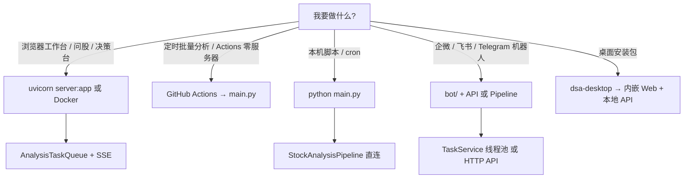

# 系统入口选型指南

面向部署与二次开发的**单一真源**：选哪种入口、任务进哪条队列、与 Web 默认行为的差异。

## 决策树

## 入口对照表

| 入口 | 典型命令 / 路径 | 分析执行 | 任务状态 | 默认外推 |
|------|-----------------|----------|----------|----------|
| **Web / API** | `uvicorn server:app` | `AnalysisService` → `StockAnalysisPipeline` | `AnalysisTaskQueue`（进程内；可选 DB 行） | `notify=false` |
| **CLI** | `python main.py` | `StockAnalysisPipeline` | 无 HTTP 队列 | 由 CLI / `.env` 决定 |
| **GitHub Actions** | workflow 调 `main.py` | 同 CLI | 无 | Secrets 配置渠道 |
| **Bot** | `bot/handler.py` | 分析命令 → API 或 `TaskService` | **Bot 专用** `TaskService` | 依 Bot 配置 |
| **Desktop** | Electron | 连本地/远程 API | 同 Web | 同 Web |

> **刻意不一致**：CLI 头部说明与 Web/API 在标的范围、 `--market-review` 等区域上可能不同；以各入口文档与 OpenAPI 为准，不以「抽象统一网关」假设行为。

## 队列边界（勿合并除非有明确 bug）

| 组件 | 模块 | 用途 |
|------|------|------|
| Web/API 队列 | `src/services/task_queue.py` | 202 异步分析、SSE、任务列表 |
| Bot 队列 | `src/services/task_service.py` | IM 侧线程池任务 |

新功能：**先对齐已有入口**，不要为理论整洁默认合并两套实现。

## 认证与多 Worker

- Web 认证开关：`SystemConfigService` + 中间件；多 worker 时需**滚动重启**全部进程。
- `AnalysisTaskQueue` 为**单进程内存态**；多 worker / 多副本部署见 [small-scale-operations.md](small-scale-operations.md)（暂不建议 SQLite 多写）。

## 产品能力分级（运行时）

`GET /api/v1/health` 响应中的 `capabilities` 字段标注稳定 / 实验能力，便于前端展示 Beta。真源：`src/product_capabilities.py`。

## 测试符号治理

- 共享美股夹具：`tests/fixtures/us_symbols.py`
- CI：`LEGACY_SYMBOL_STRICT_TESTS=1`（已接入 `ci_gate.sh`）阻断未白名单测试文件中的 legacy 符号；拒收/市场判定类用例见 `check_legacy_cn_symbols_in_tests.py` 的 `ALLOWLIST_TEST_FILENAMES`。

## 相关文档

- [architecture-detailed-guide.md](architecture-detailed-guide.md) — 主链路序列图  
- [web-workspace.md](web-workspace.md) — 路由与决策台  
- [api-v1-surface.md](api-v1-surface.md) — OpenAPI 与前端封装对照  
- [small-scale-operations.md](small-scale-operations.md) — 小流量不必做清单  
