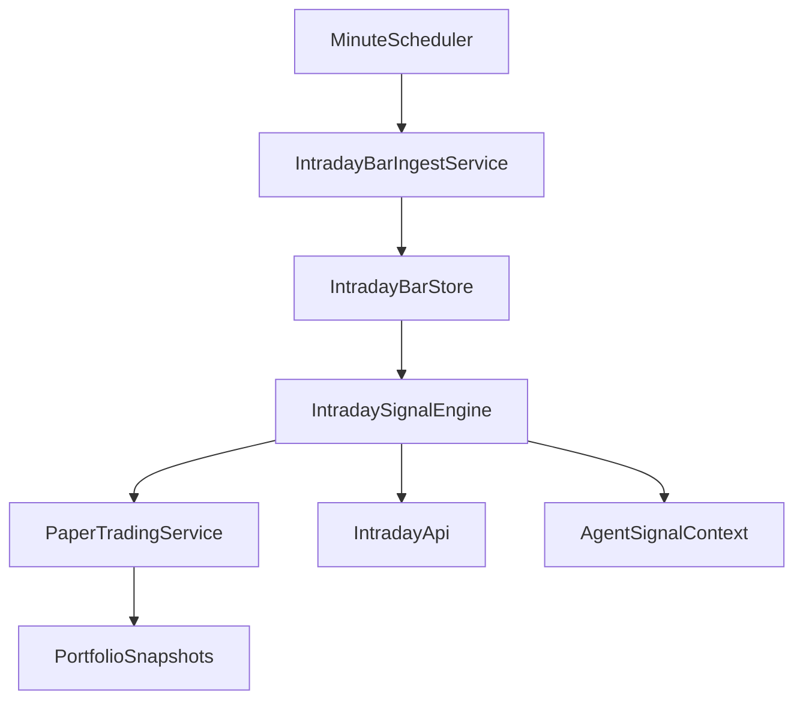

# Intraday 路由与日线信号：方案文档

> 本文档是 **intraday 相关能力** 在仓库内的说明真源：当前产品默认以 **日线（`1d`）** 为主；`/api/v1/intraday/*` 路径名保留以降低迁移成本。  
> 下方 **附录** 保留早期「分钟级日内」分阶段草案，供后续若重新启用分钟决策时参考。

---

## 一、日线级信号重构（Daily Signal Refactor）

### 1.1 目标与范围

- **后端**：保留现有 `/api/v1/intraday/*` 路由与数据库表名（如 `stock_intraday_bar`、`intraday_signal_record`），避免一次性重命名波及 API、前端、测试与迁移。
- **行为**：默认 **`interval=1d`**；回溯窗口以 **`lookback_days`** 为主表达；必要时 **短期兼容** 旧查询参数 `lookback_minutes`（按「分钟 / 1440」折算为天，并 clamp 到合理区间）。
- **前端**：页面与文案从「日内 / 分钟」调整为 **日线 / 日级**；默认回溯按 **天数**；后台调度默认轮询改为 **低频**（例如 3600 秒），适配日线刷新节奏。
- **非目标**：不改变「不向券商真实报单」与 Paper Trading 本地模拟的定位。

### 1.2 后端改动要点

| 区域 | 文件 | 说明 |
|------|------|------|
| API | [`api/v1/endpoints/intraday.py`](../api/v1/endpoints/intraday.py) | `/bars`、`/signal`、`/signals/batch` 默认 `interval=1d`；支持 `lookback_days`；兼容 `lookback_minutes`；错误文案对齐「日线」语义。 |
| Schema | [`api/v1/schemas/intraday.py`](../api/v1/schemas/intraday.py) | 调度请求默认 `intervals=["1d"]`；`lookback_days`；可选保留 `lookback_minutes` 兼容；`poll_seconds` 默认提高间隔。 |
| 服务 | [`src/services/intraday_signal_service.py`](../src/services/intraday_signal_service.py) | `interval=1d` 时走 `DataFetcherManager.get_daily_data`，将结果规范为与 bar 存储一致的 DataFrame 再落库；非 `1d` 仍可走分钟 intraday 拉取。 |
| 调度 | [`src/services/intraday_scheduler_service.py`](../src/services/intraday_scheduler_service.py) | Job 配置使用 `lookback_days`；轮询默认低频。 |
| 数据源 | [`data_provider/yfinance_fetcher.py`](../data_provider/yfinance_fetcher.py) | `get_intraday_data` 在 `interval` 为日线别名时，可委托 `get_daily_data` 并映射为统一 bar 列（`timestamp`、OHLCV、`interval=1d` 等）。 |
| 引擎 | [`src/core/intraday_signal_engine.py`](../src/core/intraday_signal_engine.py) | 日线模式下避免「开盘 30 分钟区间」等分钟语义；VWAP/区间类指标改为滚动窗口或日线可读文案；`setup` 等区分 daily / intraday。 |

### 1.3 Web 改动要点

| 区域 | 文件 | 说明 |
|------|------|------|
| API 封装 | [`apps/dsa-web/src/api/intraday.ts`](../apps/dsa-web/src/api/intraday.ts) | 默认 `interval=1d`；查询参数 `lookback_days`；调度默认 `intervals: ['1d']`、`poll_seconds` 提高。 |
| 类型 | [`apps/dsa-web/src/types/intraday.ts`](../apps/dsa-web/src/types/intraday.ts) | `IntradayInterval` 等包含 `1d`（可保留旧分钟枚举以兼容历史数据）。 |
| 决策台 | [`apps/dsa-web/src/pages/DecisionPage.tsx`](../apps/dsa-web/src/pages/DecisionPage.tsx) | 主 Web 入口：`/decision`；`/intraday` 重定向；批量 `/signals/batch` + 本地提醒流。 |
| API 封装 | [`apps/dsa-web/src/api/intraday.ts`](../apps/dsa-web/src/api/intraday.ts) | 仅 `getSignalBatch` / `getLatestSignal`（调度与 paper 不在 Web 暴露）。 |
| 导航 | [`apps/dsa-web/src/components/layout/SidebarNav.tsx`](../apps/dsa-web/src/components/layout/SidebarNav.tsx) | 侧栏仅 **决策**，无独立「日线」页。 |

### 1.4 测试与文档

- **测试**：更新 [`tests/test_intraday_api.py`](../tests/test_intraday_api.py)、[`tests/test_api_v1_smoke_matrix.py`](../tests/test_api_v1_smoke_matrix.py)、[`tests/test_intraday_signal_engine.py`](../tests/test_intraday_signal_engine.py)、[`tests/test_intraday_repository.py`](../tests/test_intraday_repository.py) 中与默认周期、参数名、断言相关的用例。
- **对外 API 说明**：同步 [`docs/api-v1-surface.md`](api-v1-surface.md) 中 intraday 查询参数说明。
- **变更记录**：在 [`docs/CHANGELOG.md`](CHANGELOG.md) 的 `[Unreleased]` 增加一条 **文档** 或 **改进** 条目（扁平一行格式）。

### 1.5 验证建议

- **后端**：对改动过的 Python 文件执行 `python -m py_compile`；尽量跑 intraday 相关 `pytest`（优先 `-m "not network"`）。
- **前端**：在 `apps/dsa-web` 执行 `npm run lint` 与 `npm run build`。
- **联网**：若环境不可访问 Yahoo 等数据源，以 mock / 单测覆盖参数与分支，不强制在线拉数。

### 1.6 兼容说明（给调用方）

- **路径**：仍为 `/api/v1/intraday/...`。
- **默认周期**：`1d`（若仍传 `1m`/`5m` 等且数据源支持，可继续走分钟链路）。
- **回溯**：优先使用 `lookback_days`；仅传 `lookback_minutes` 时由服务端折算为天（兼容旧客户端）。

---

## 附录：分钟级日内交易分阶段方案（历史草案）

以下内容为 **早期「分钟级滚动决策」** 的规划草案；当前默认产品路径已切换为 **日线信号**（见上文）。若未来重新启用分钟级，可据此分阶段落地。

### 目标与边界（原稿）

第一阶段目标：

- 支持 **分钟级 K 线**（至少 `1m / 5m / 15m`）采集、缓存与查询。
- 支持 **每分钟滚动决策**，输出结构化信号，而不是仅日线报告。
- 支持 **paper trading**：模拟账户、持仓、成交、权益曲线与基础风控。
- **不纳入真实下单**；真实交易接口放到后续阶段。

本方案以以下前提为真源：

- 市场与主路径：**美股 / 美期货 / 加密**，沿用现有 `yfinance` 主链路。
- 决策频率：**每分钟滚动决策**。
- 账户模式：**paper trading**。

### 现状判断（原稿）

当前代码主路径明显是 **日线架构**：

- `data_provider/base.py` 与 fetcher 统一入口是 `get_daily_data`。
- `data_provider/longbridge_fetcher.py` 历史 K 线实现写死 `Period.Day`。
- `src/storage.py` 的 `StockDaily` 以 `date` 为主键维度，只适合日线。
- `src/core/pipeline.py` 的主分析链是“日线 + 实时报价补强”，不是分钟序列。
- `src/core/backtest_engine.py` 是“基于日 K 的建议评估”，不是分钟级撮合引擎。
- 历史版本曾有日级组合账本实现，已移除；分钟级 paper 账本以 `paper_trading_*` / `portfolio_intraday_snapshots` 等为真源。

### 目标架构（原稿）

设计原则：

- **分钟级能力单独成层**，不要把高频循环硬塞进现有 `AnalysisTaskQueue`。
- **信号真源放在 service + DB**，LLM/Agent 只消费信号解释，不反过来主导撮合。
- **paper trading 使用独立账户/订单/成交模型**，分钟级权益与 `portfolio_intraday_snapshots` 等单独扩展。
- **保留现有日线 pipeline**，先与 intraday 平行运行，通过 feature flag 接入。

### 工作流分阶段（原稿）

#### 阶段 1：建立分钟数据能力

目标：补齐 `1m / 5m / 15m` 数据获取、标准化、存储与查询。

主要改动：

- 在 `data_provider/base.py` 新增统一的 **intraday bars** 抽象，例如 `get_intraday_data(code, interval, lookback)`，不要污染原 `get_daily_data` 语义。
- 在 `data_provider/yfinance_fetcher.py` 新增分钟级下载路径与标准列规范。
- 为未来多源兼容预留接口；`data_provider/longbridge_fetcher.py` 先只做接口占位或第二阶段接入，不必在首阶段全部完成。
- 在 `src/storage.py` 新增独立分钟表，例如 `stock_intraday_bar`，主键建议按 `code + interval + bar_start`。
- 在新建的 repo（如 `src/repositories/intraday_repo.py`）封装分钟线读写、范围查询、最近 N 根查询。

关键约束：

- 使用 `timestamp`/`bar_start` 而不是 `date`。
- 同时保留 `interval` 字段，避免 1m/5m/15m 混表歧义。
- 需要明确定义时区与 session 归属，沿用 `docs/timezone-policy.md` 的 UTC 存储方向。

#### 阶段 2：新增分钟级指标与信号引擎

目标：把日线 `StockTrendAnalyzer` 拆出可复用部分，建立 **分钟级 IntradaySignalEngine**。

主要改动：

- 保持 `src/stock_analyzer.py` 的日线分析器不被分钟参数污染；新增 `src/core/intraday_signal_engine.py`。
- 第一批指标：`VWAP`、`EMA/MA`、`MACD`、`RSI`、量价、开盘区间、最近高低点；其中 **VWAP** 采用 session 内累计语义。
- 输出统一的结构化信号模型，如 `signal / confidence / setup / invalidation / timestamp / interval / reasons`。
- 如需与 Agent 共享，在 `src/agent/tools/analysis_tools.py` 新增 intraday 专用工具，而不是让 `analyze_trend` 混合两套时域。

关键约束：

- 不复用 `MA5` 这类日线含义不清的字段名作为跨时域真源。
- 分钟级指标参数显式与 interval 绑定，例如 `ema_fast_9_on_1m`、`vwap_session`。

#### 阶段 3：构建每分钟滚动调度

目标：形成“拉分钟线 -> 算信号 -> 落库”的常驻或准常驻循环。

主要改动：

- 新建 `src/services/intraday_scheduler_service.py` 与 `src/services/intraday_signal_service.py`。
- 不把此能力塞进 `src/services/task_queue.py` 主语义中；若要重用线程池，仅复用实现细节，不复用产品语义。
- 在 `main.py` 增加显式入口，例如后续可扩展 `--intraday` 或 `--intraday-paper`，但第一版可先通过 service / API 触发。
- 在 `api/app.py` 生命周期中挂 intraday service 的懒初始化入口，而非默认自启动所有高频任务。

关键约束：

- 滚动决策以 **当前分钟完成的 bar** 为触发点，不使用未完成 bar 作为真源，除非明确引入“预警信号”层。
- 分钟引擎要与日线 pipeline 隔离资源配额，避免搜索/LLM 挤占行情线程。

#### 阶段 4：paper trading 账本与撮合

目标：把分钟级信号接入模拟账户，形成“信号 -> 订单 -> 成交 -> 持仓 -> 权益”的闭环。

主要改动：

- 实现 **paper account / order / fill / minute snapshot** 语义（独立仓储与服务，不依赖已移除的组合账本）。
- 在 `src/storage.py` 补充 `paper_order`、`paper_fill`、`portfolio_intraday_snapshot` 等模型，避免强扭现有日快照。
- 新建 `src/services/paper_trading_service.py`，负责下单规则、滑点、手续费、仓位限制、止盈止损触发。
- 为后续回放/可视化预留 `order_status`、`filled_qty`、`avg_fill_price`、`realized_pnl`、`unrealized_pnl` 字段。

关键约束：

- 第一阶段采用简化成交模型：按当前 bar 的 close/next bar open/或 configurable fill rule 执行。
- 不复用 `src/core/backtest_engine.py` 作为撮合主引擎，只借鉴 bar 推进与止损止盈逻辑风格。

#### 阶段 5：API、Web 与 Agent 接入

目标：让分钟级数据、信号与 paper trading 可观测、可操作。

主要改动：

- 新增 intraday API，例如：分钟线查询、最新信号、paper 账户状态、订单列表、权益曲线。
- 建议在 `api/v1/endpoints` 下新增 `intraday.py` 与 `paper_trading.py`，不要继续堆在 `analysis.py`。
- Web 第一阶段只做最小闭环：实时信号面板、当前持仓、订单/权益曲线。
- Agent 侧仅消费 intraday signal 结果做解释，可在 `src/agent/orchestrator.py` / `src/agent/tools` 增加新上下文或工具，但不要让 Agent 直接充当撮合引擎。

### 关键文件清单（原稿）

优先级最高的代码入口：

- `data_provider/base.py`
- `data_provider/yfinance_fetcher.py`
- `src/storage.py`
- `src/core/pipeline.py`
- `src/stock_analyzer.py`
- `src/services/task_queue.py`
- `src/core/backtest_engine.py`
- `src/agent/tools/analysis_tools.py`

建议新增的文件：

- `src/repositories/intraday_repo.py`
- `src/core/intraday_signal_engine.py`
- `src/services/intraday_signal_service.py`
- `src/services/intraday_scheduler_service.py`
- `src/services/paper_trading_service.py`
- `api/v1/endpoints/intraday.py`
- `api/v1/endpoints/paper_trading.py`

### 风险与取舍（原稿）

- `yfinance` 的分钟数据可用性、回溯深度、限流与稳定性可能成为第一阶段瓶颈；架构上要保留后续切换 Longbridge/其他源的接口。
- 若把分钟任务直接塞进现有分析队列，会把“日线分析任务”和“高频信号循环”耦合，建议避免。
- 若强行在现有 `StockTrendAnalyzer` 里同时承载日线与分钟策略，后续参数语义会失控，建议新建 intraday engine。
- `paper trading` 与当前 backtest 的语义不同，必须单独建模订单与成交状态。

### 验证策略（原稿）

- 数据层：分钟线拉取、去重、补齐、时区归档测试。
- 指标层：VWAP / EMA / MACD / RSI 的固定样本单测。
- 服务层：每分钟调度、重复 bar 幂等、信号落库测试。
- paper trading：下单、成交、止盈止损、权益曲线测试。
- API：最新信号 / 订单 / 账户状态接口契约测试。

### 交付建议（原稿）

建议按 3 个 PR 交付，降低风险：

1. **分钟数据基础设施**：fetcher + storage + repo。
2. **Intraday signal engine**：指标、信号、最小 API。
3. **Paper trading**：账户、订单、撮合、权益与前端/API 接口。
